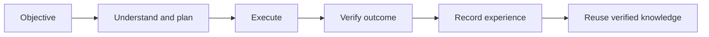

# S.Y.N.A.

**Self-evolving Yielding Neural Architecture — experimental AI agent research**

S.Y.N.A. is an independent Python project exploring how an AI-assisted system can plan, act, verify outcomes, retain experience and extend its capabilities under controlled conditions.

## Research question

How can an agent distinguish actual task completion from a tool's self-reported success, and evaluate new capabilities before using them?

## High-level workflow

## Documented prototype capabilities

- Structured planning and tool execution.
- Independent outcome verification, including detection of incorrect results reported as successful.
- Separation of recorded experience and reusable procedures.
- Experimental, opt-in capability acquisition with candidate testing and a verification gate before promotion.
- Positive and negative automated test scenarios.

## Scope and limitations

This is an experimental architecture, not a production-ready autonomous AI or a claim of AGI. The documented initial version has limited task scope. Candidate process isolation and static checks are not a complete security boundary. Unrestricted self-modification and guaranteed autonomous improvement are not claimed.

## Engineering focus

Python, agent orchestration, software architecture, automated testing, reliability and controlled capability development.

## Repository policy

This showcase contains a high-level description only. The implementation, internal configuration, test fixtures and private development history are not published here. No new test run or independent performance benchmark is claimed by this document.
